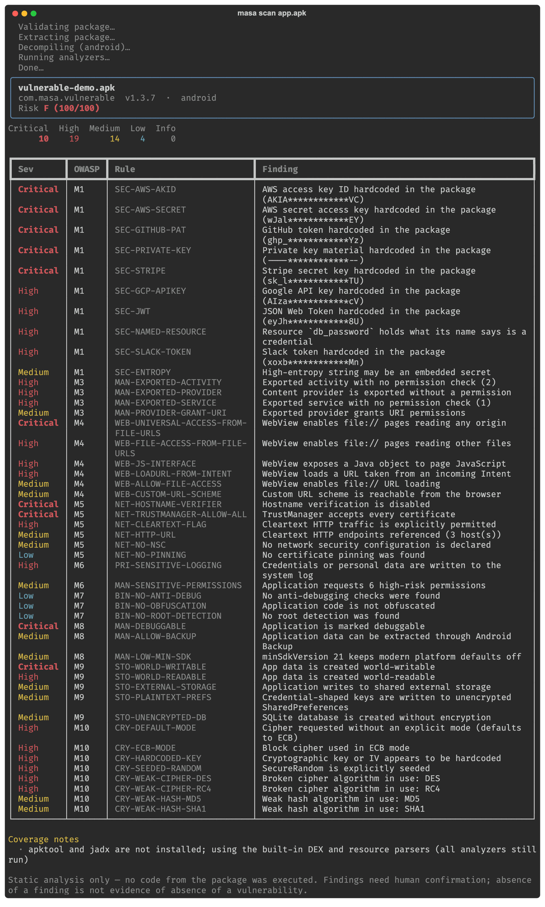
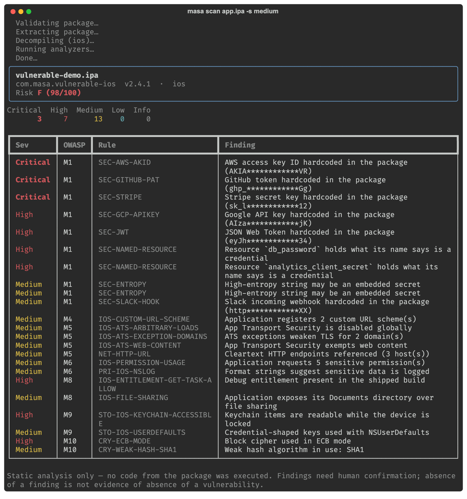
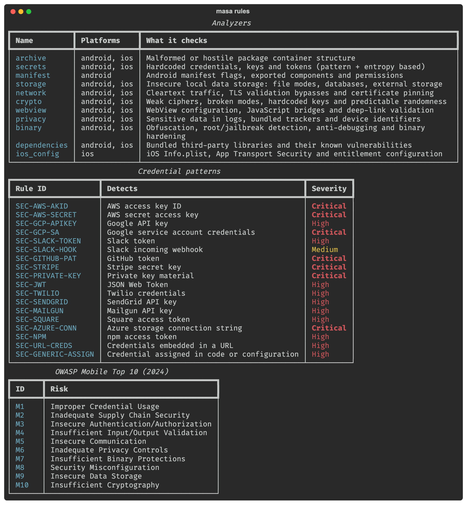
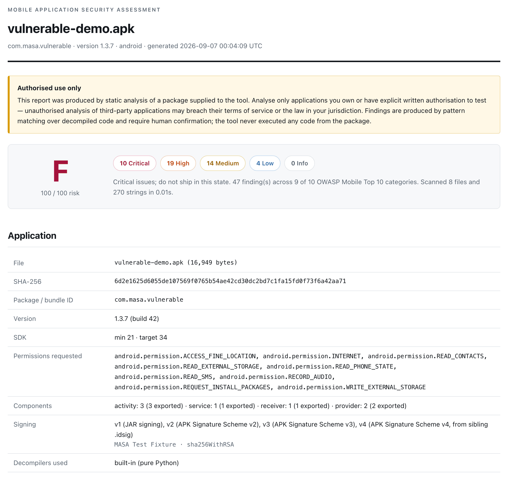
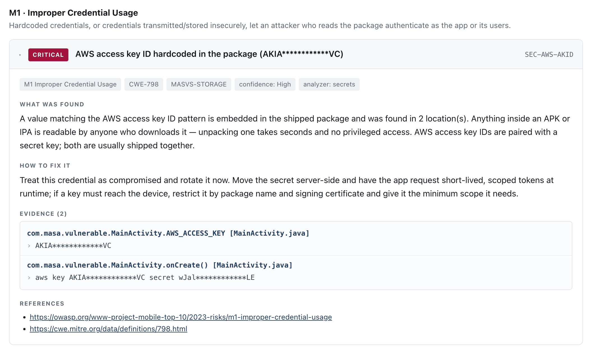
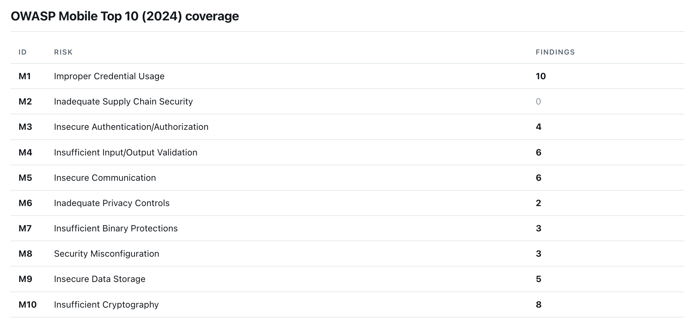

<h1 align="center">Mobile App Security Analyzer</h1>

<p align="center">
  <em>Static security analysis for Android APKs and iOS IPAs, mapped to the
  OWASP Mobile Top 10 (2024) and MASVS.</em>
</p>

<p align="center">
  <a href="https://github.com/lostcharonprivate-del/mobile-app-security-analyzer/actions/workflows/ci.yml"></a>
  <a href="https://www.python.org/downloads/"></a>
  <a href="LICENSE"></a>
  <a href="#owasp-mobile-top-10-2024-mapping"></a>
  <a href="#testing"></a>
  <a href="#docker"></a>
</p>

<p align="center">
  <a href="#quick-start">Quick start</a> ·
  <a href="#what-it-detects">What it detects</a> ·
  <a href="#example-report">Example report</a> ·
  <a href="#architecture">Architecture</a> ·
  <a href="CONTRIBUTING.md">Contributing</a> ·
  <a href="SECURITY.md">Security</a>
</p>

---

It unpacks a package, decompiles it, pattern-matches the code and configuration,
and produces a scored report mapped to the **OWASP Mobile Top 10 (2024)** and
**OWASP MASVS**.

It is **static analysis only**: the tool decompiles, reads and pattern-matches.
It never installs, runs, or executes anything from the package under analysis.

<p align="center">
  
</p>
<p align="center">
  <sub><code>masa scan tests/fixtures/vulnerable-demo.apk</code> against the
  intentionally-vulnerable demo app built from source in
  <a href="tests/fixtures/android_src/"><code>tests/fixtures/android_src/</code></a>.</sub>
</p>

---

## Authorised use only

**Analyse only applications you own or have explicit written authorisation to
test.** Unauthorised analysis of third-party applications may breach their terms
of service or the law in your jurisdiction. The tool shows this notice on first
run and repeats it at the top of every report.

Two further commitments, both enforced in code and covered by tests:

- **Nothing phones home.** Analysis is entirely local. The only network request
  the tool can ever make is an OSV.dev vulnerability lookup, which is **off by
  default** and requires `--online`. Even then, the only data transmitted is a
  library name and version string — never file contents, never a hash of the
  analysed app, never a filename. (`tests/test_security_network.py` asserts this
  by intercepting the transport.)
- **Every package is treated as hostile input.** Archives are validated before
  extraction, unpacked into a private mode-0700 sandbox, and wiped afterwards
  unless you pass `--keep-artifacts`. Path traversal, symlink members, zip bombs
  and oversized entries are refused. Every external decompiler runs with no
  shell, a scrubbed environment, a wall-clock timeout and process-group kill.

---

## Quick start

```bash
git clone https://github.com/lostcharonprivate-del/mobile-app-security-analyzer.git
cd mobile-app-security-analyzer
pip install -e .

masa scan path/to/app.apk
```

Python 3.11 or newer. Three dependencies (typer, rich, jinja2) — the
decompilation layer is pure Python, so apktool and jadx are optional.

Write reports instead of terminal output:

```bash
masa scan app.apk --format all --output report
```

That produces `report.html` (self-contained, no external assets) and
`report.json` (for CI or further tooling).

The same command works on an IPA — the platform is detected from the package
contents, not the file extension:

<details>
<summary><code>masa scan app.ipa -s medium</code> on the iOS demo package</summary>

<p align="center">
  
</p>
</details>

### Docker

Reproducible environment with apktool and jadx bundled, so nothing needs to be
hand-installed:

```bash
docker compose build
```

Then drop a package in `./workspace/` and run:

```bash
docker compose run --rm masa scan /work/app.apk -f all -o /work/report
```

The container runs with `network_mode: none`, a read-only root filesystem, all
capabilities dropped and an unprivileged user — the offline guarantee becomes a
property of the sandbox, not only of the code. Use the `masa-online` service if
you want `--online` dependency lookups.

---

## Usage

```
masa scan <file>          Analyse an APK or IPA
masa rules                List analyzers, credential patterns and the OWASP mapping
masa notice               Show the legal and ethical use notice
masa version
```

Common options:

| Option | Effect |
|---|---|
| `-f, --format` | `terminal` (default), `html`, `json`, or `all` |
| `-o, --output` | Where to write the report |
| `-s, --severity` | Lowest severity to report (default `info`) |
| `--fail-on` | Exit 1 when a finding at this severity or higher is present |
| `--online` | Allow OSV.dev lookups for bundled libraries (off by default) |
| `--keep-artifacts` | Keep the decompiled tree for your own review |
| `--disable-rule` | Suppress a rule by ID (repeatable) |
| `--disable-analyzer` | Skip an analyzer by name (repeatable) |
| `--max-size-mb` | Reject packages larger than this |

### Exit codes

Chosen so the tool drops into CI:

| Code | Meaning |
|---|---|
| `0` | Scan completed; nothing at or above `--fail-on` |
| `1` | Scan completed; findings at or above `--fail-on` |
| `2` | Package refused (invalid, or a safety limit was hit) |
| `3` | Unexpected error |

```bash
masa scan build/app-release.apk --fail-on high -f json -o report.json
```

---

## What it detects

Eleven analyzer plugins, one per check category. `masa rules` prints the full
list at any time — analyzers, every credential pattern with its severity, and the
OWASP mapping:

<details>
<summary><code>masa rules</code></summary>

<p align="center">
  
</p>
</details>

| Analyzer | Checks |
|---|---|
| `archive` | Package containers built to attack the analyzer: path traversal, symlink members, extension/content mismatch |
| `secrets` | ~18 credential patterns (AWS, GCP, GitHub, Stripe, Slack, Twilio, SendGrid, Azure, private keys, JWTs…), plus Shannon-entropy scoring and credential-named resources |
| `manifest` | `debuggable`, `allowBackup`, `testOnly`, exported components without permission checks, weak custom permissions, task hijacking, low `minSdkVersion` |
| `storage` | `MODE_WORLD_READABLE`/`WRITEABLE`, unencrypted SQLite, external storage writes, plaintext preferences, iOS `NSUserDefaults` and Keychain accessibility |
| `network` | `usesCleartextTraffic`, weak network security config, TrustManagers that accept anything, always-true hostname verifiers, cleartext HTTP endpoints, missing pinning |
| `crypto` | DES/RC4/3DES/Blowfish, ECB mode, implicit-ECB defaults, MD5/SHA-1, seeded `SecureRandom`, hardcoded keys and IVs |
| `webview` | `addJavascriptInterface`, file/universal access from `file://` URLs, `loadUrl` fed from an Intent, browsable custom URL schemes |
| `privacy` | Credentials and PII in logs, persistent device identifiers, 20 bundled analytics/ad SDKs |
| `binary` | Obfuscation, root/jailbreak detection, anti-debugging, PIE, FairPlay encryption, bundled native libraries |
| `dependencies` | Bundled component inventory and OSV.dev advisory lookup |
| `ios_config` | App Transport Security exceptions, URL schemes, permission usage strings, file sharing, debug entitlements |

Each finding carries a severity, an OWASP Mobile Top 10 ID, a CWE reference, a
MASVS control group, a confidence level, precise locations, a plain-language
explanation and remediation advice.

### Findings that are absences, not defects

Missing root detection, missing anti-debugging and missing obfuscation are
reported at **Low**, and each finding says explicitly that it is an absent
hardening measure rather than a vulnerability. These controls are bypassable by
an attacker who controls the device and are not appropriate for every app;
they are reported so the decision is deliberate, not accidental.

---

## OWASP Mobile Top 10 (2024) mapping

| ID | Risk | What maps to it |
|---|---|---|
| **M1** | Improper Credential Usage | Hardcoded API keys, tokens, private keys; credential-named resources; high-entropy literals |
| **M2** | Inadequate Supply Chain Security | Bundled library inventory; OSV.dev advisories for versions that can be determined |
| **M3** | Insecure Authentication/Authorization | Exported activities, services, receivers and content providers with no permission check; weak custom permission protection levels |
| **M4** | Insufficient Input/Output Validation | `addJavascriptInterface`, file/universal access from `file://`, `loadUrl` from Intent data, browsable custom URL schemes |
| **M5** | Insecure Communication | `usesCleartextTraffic`, ATS exceptions, TrustManagers accepting any certificate, always-true hostname verifiers, cleartext HTTP endpoints, missing pinning |
| **M6** | Inadequate Privacy Controls | Credentials and PII in logs, persistent device identifiers, over-broad permissions, bundled trackers |
| **M7** | Insufficient Binary Protections | No obfuscation, no root/jailbreak detection, no anti-debugging, symbols intact, non-PIE binaries |
| **M8** | Security Misconfiguration | `debuggable=true`, `allowBackup=true`, `testOnly`, iOS file sharing, `get-task-allow`, hostile archive structure |
| **M9** | Insecure Data Storage | World-readable/writable files, unencrypted databases, external storage, `NSUserDefaults`, weak Keychain accessibility |
| **M10** | Insufficient Cryptography | Broken ciphers and modes, weak hashes, hardcoded keys and IVs, seeded `SecureRandom` |

MASVS control groups (`MASVS-STORAGE`, `MASVS-CRYPTO`, `MASVS-NETWORK`,
`MASVS-PLATFORM`, `MASVS-CODE`, `MASVS-RESILIENCE`, `MASVS-PRIVACY`,
`MASVS-AUTH`) are attached to findings as a second, control-oriented axis.

---

## Architecture

```
                 ┌─────────────────────────┐
   APK / IPA ──▶ │  Ingestion & Validation │  magic bytes, platform by content,
                 │  (masa/ingest)          │  zip-bomb + traversal + symlink refusal
                 └────────────┬────────────┘
                              ▼
                 ┌─────────────────────────┐
                 │  Sandbox                │  mode-0700 temp dir, wiped after;
                 │  (masa/ingest/sandbox)  │  subprocesses: no shell, timeout,
                 └────────────┬────────────┘  scrubbed env, process-group kill
                              ▼
                 ┌─────────────────────────┐
                 │  Decompiler Layer       │  Android: AXML + DEX + ARSC + APK
                 │  (masa/decompile)       │           signing block (pure Python)
                 │                         │  iOS:     plist + Mach-O (pure Python)
                 │                         │  optional: apktool, jadx, class-dump
                 └────────────┬────────────┘
                              ▼
                 ┌─────────────────────────┐
                 │  ScanContext            │  read-only view: strings, text files,
                 │  (masa/context.py)      │  manifest tree, classes, call sites
                 └────────────┬────────────┘
                              ▼
                 ┌─────────────────────────┐
                 │  Analysis Engine        │  11 plugins; a failing rule is
                 │  (masa/analyzers)       │  contained, never loses the report
                 └────────────┬────────────┘
                              ▼
                 ┌─────────────────────────┐
                 │  OWASP Mapper + Scorer  │  severity x confidence, per-rule cap,
                 │  (masa/scoring.py)      │  saturating curve to 0-100 and A-F
                 └────────────┬────────────┘
                              ▼
                 ┌─────────────────────────┐
                 │  Report Generator       │  HTML (autoescaped, self-contained)
                 │  (masa/report)          │  JSON (versioned schema)
                 └─────────────────────────┘
```

### No hard dependency on apktool or jadx

The decompilation layer is pure Python and complete enough to run every analyzer:

- **`axml.py`** decodes compiled `AndroidManifest.xml`, resolving attributes by
  string *and* by Android resource ID, so a manifest whose attribute-name pool
  has been stripped still parses.
- **`dex.py`** parses the DEX tables and walks the instruction stream. It tracks
  constants in registers, so a finding can say
  `getSharedPreferences(…, MODE_WORLD_READABLE)` rather than just
  "this app calls getSharedPreferences" — and can tell `setJavaScriptEnabled(true)`
  from `(false)`. It also classifies trivial method bodies, which is how an
  `X509TrustManager` whose `checkServerTrusted` does nothing is identified.
  Static-final string values are attributed to the field that holds them.
- **`arsc.py`** walks `resources.arsc` type chunks to pair resource *names* with
  their values, so a finding reads `res/values/strings.xml:google_api_key`.
- **`macho.py`** reads the Mach-O header, load commands and the
  `__objc_classname` / `__objc_methname` sections — recovering Objective-C class
  and selector names without `class-dump`, which is macOS-only.

apktool and jadx are used when present, purely to add decoded resources and
readable source. When they are absent the report says so explicitly rather than
quietly producing a thinner result.

---

## Example report

The HTML report is self-contained — one file, no external assets, no scripts —
so it can be attached to a ticket or archived as a build artifact.

<p align="center">
  
</p>

Every finding states its OWASP category, CWE, MASVS control group and confidence,
then what was found, how to fix it, and precisely where it came from. Credentials
are redacted everywhere they appear — a guarantee
[`test_security_report.py`](tests/test_security_report.py) enforces across the
HTML, JSON, titles and metadata:

<p align="center">
  
</p>

Coverage is reported against all ten categories, including the ones with nothing
in them, so a clean category is visibly clean rather than merely absent:

<p align="center">
  
</p>

`examples/vulnerable-demo-report.html` is generated from
`tests/fixtures/vulnerable-demo.apk`, an intentionally-vulnerable app built from
source in `tests/fixtures/android_src/` by the real Android toolchain (aapt2,
d8, apksigner). Regenerate it with:

```bash
tests/fixtures/build_android_fixture.sh
masa scan tests/fixtures/vulnerable-demo.apk -f all -o examples/vulnerable-demo-report
```

An iOS equivalent is built by `tests/fixtures/build_ios_fixture.sh`, which
compiles a genuine arm64 iOS Mach-O with clang against the iPhoneOS SDK.

The demo app scores **F (100/100)** with 47 findings across 9 of the 10 OWASP
categories. It also contains a `SecureHelper` class that uses the same APIs
*correctly* — the test suite asserts that nothing in it is ever reported.

---

## Testing

```bash
pip install -e ".[dev]"
pytest
```

439 tests, 88% line coverage. The suite is deliberately weighted towards the
tool's own attack surface, because a security analyzer processes files supplied
by exactly the people it is used to investigate.

| File | Covers |
|---|---|
| `test_security_ingestion.py` | Zip bombs (ratio, entry count, declared size, headers that lie while streaming), path traversal in 9 encodings, symlink members and the symlink-directory redirect, device/FIFO members, duplicate names, encrypted members, extension spoofing, nested archives, sandbox lifecycle and permissions, subprocess shell-injection, timeouts, grandchild process kill, environment scrubbing |
| `test_security_parsers.py` | Every binary parser against targeted length/count corruption, systematic truncation and ~2,000 random-mutation iterations. Contract: terminate inside 10s, raise only `ParseError`, never exhaust memory |
| `test_security_xml.py` | Billion laughs, XXE local file read, XXE SSRF to cloud metadata, parameter entities, entities smuggled inside an Apple plist DOCTYPE — while still accepting the standard Apple DOCTYPE that real plists carry |
| `test_security_report.py` | 11 XSS payloads through every report field, `javascript:`/`data:` URL schemes in references, and the guarantee that no credential appears in usable form in HTML, JSON, titles or metadata |
| `test_security_network.py` | Offline by default, verified by intercepting the transport; a canary string planted in a package must not appear on the wire; requests carry only a library coordinate |
| `test_analyzers_android.py` | Expected detections on the compiled fixture, evidence attribution, and false-positive controls (`MODE_PRIVATE`, AES-GCM, SHA-256, HTTPS endpoints, guarded providers, the launcher activity, AWS's documentation example key) |
| `test_analyzers_ios.py` | ATS, entitlements, Keychain accessibility, Mach-O facts checked against what clang actually emitted |
| `test_degradation.py` | Missing, failing and timing-out external tools; corrupt DEX, manifest and plist; text manifests; multidex; minimal packages |
| `test_core.py` | Models, scoring properties, redaction in every syntactic shape, analyzer registry, error containment, determinism |
| `test_cli.py` | Output formats, exit codes, filters, the first-run notice |

Fixtures are built by real toolchains rather than hand-assembled, so the parsers
are exercised against genuine compiler output. Several parser results are
cross-checked against ground truth from `aapt`, `apksigner` and `otool`.

---

## Limitations

Worth stating plainly, because a report that overclaims is worse than no report:

- **Static only.** No runtime behaviour, no actual network traffic, no
  server-side controls. Logic assembled dynamically, loaded after install, or
  hidden behind reflection is invisible to it.
- **Native code is not analysed.** Bundled `.so` libraries are inventoried and
  flagged as uncovered, not examined.
- **Obfuscation reduces coverage.** Renamed classes and encrypted strings defeat
  pattern matching, as intended by whoever applied them.
- **Dependency versions are often undeterminable.** A built package carries no
  dependency manifest. Versions are recovered from `META-INF/*.version` markers,
  Maven `pom.properties` and embedded version constants; libraries without one
  are reported as unverifiable rather than silently skipped.
- **Findings need human confirmation.** Rules match patterns, not proofs. Each
  finding states its confidence, and low-confidence rules say what else the
  match could be.
- **Absence of a finding is not evidence of absence of a vulnerability.**

## Repository layout

```
masa/                        The package
├── cli.py                   Typer entry point: scan, rules, notice, version
├── runner.py                Orchestration — ingest, decompile, analyse, score, report
├── config.py                ScanConfig: limits, filters, disabled rules
├── context.py               ScanContext, the read-only view analyzers see
├── models.py                Finding, Evidence, Report and the JSON schema version
├── patterns.py              Credential patterns and entropy scoring
├── scoring.py               Severity x confidence, per-rule cap, 0-100 and A-F
├── redact.py                Credential redaction, applied before anything is rendered
├── osv.py                   The one optional network call, gated behind --online
├── errors.py                ParseError and the refusal taxonomy behind exit code 2
├── ingest/                  Validation, the mode-0700 sandbox, subprocess isolation
├── decompile/               axml.py · dex.py · arsc.py · macho.py — all pure Python
├── analyzers/               The eleven analyzer plugins, one per check category
└── report/                  HTML (autoescaped, self-contained), JSON, PDF

tests/                       439 tests, weighted towards the tool's own attack surface
└── fixtures/                Vulnerable demo app sources + real-toolchain build scripts

examples/                    Checked-in reports generated from the demo fixtures
docs/images/                 Screenshots used by this README
workspace/                   Mount point for the Docker image; drop packages here
.github/                     CI, issue and pull request templates, Dependabot
```

Reports, built fixtures and the virtualenv are gitignored; the two reports under
`examples/` are re-included deliberately, because they are a deliverable.

---

## Project documentation

| | |
|---|---|
| [CONTRIBUTING.md](CONTRIBUTING.md) | Development setup, the two non-negotiable rules, and what a new rule needs |
| [SECURITY.md](SECURITY.md) | Private vulnerability reporting, and the threat model that defines what is in scope |
| [CHANGELOG.md](CHANGELOG.md) | Release history. Rule IDs are public API — renaming one is a breaking change |
| [CODE_OF_CONDUCT.md](CODE_OF_CONDUCT.md) | Contributor Covenant, plus the two rules specific to a security tool |

---

## Licence

[MIT](LICENSE).
